# 基于微信小程序的新生自助报到系统--论文

> 🎓 **计算机毕业设计 · 基于微信小程序的新生自助报到系统--论文**
>
> 本仓库只放**项目介绍 + 运行截图**（截图是站点带水印的原图，存在仓库 `images/` 里）。
>
> 👉 **完整可运行源码 / 数据库脚本 / 部署文档：[点我获取](https://geekcode.top/archives/%E5%9F%BA%E4%BA%8E%E5%BE%AE%E4%BF%A1%E5%B0%8F%E7%A8%8B%E5%BA%8F%E7%9A%84%E6%96%B0%E7%94%9F%E8%87%AA%E5%8A%A9%E6%8A%A5%E5%88%B0%E7%B3%BB%E7%BB%9F-%E8%AE%BA%E6%96%87?utm_source=github)**
>
> 💬 咨询微信：**ir9372**　|　🌐 更多项目：[极客代码 geekcode.top](https://geekcode.top/?utm_source=github)
>
> 📌 项目详情页：<https://geekcode.top/archives/%E5%9F%BA%E4%BA%8E%E5%BE%AE%E4%BF%A1%E5%B0%8F%E7%A8%8B%E5%BA%8F%E7%9A%84%E6%96%B0%E7%94%9F%E8%87%AA%E5%8A%A9%E6%8A%A5%E5%88%B0%E7%B3%BB%E7%BB%9F-%E8%AE%BA%E6%96%87?utm_source=github>

<table><td width="230" align="center"> <b>扫码加微信 ir9372</b></td><td valign="middle">📦 源码 = 项目介绍 + 全部运行截图 + 数据库 + 部署文档 👉 点上方任意截图，直接跳到 <b>极客代码 geekcode.top</b> 详情页</td></table>

---

<h1>基于微信小程序的新生自助报到系统--论文</h1>
<h2>项目概述</h2>

本项目名为“基于微信小程序的新生自助报到系统”，旨在利用移动互联网技术优化高校新生入学报到流程。系统采用前后端分离架构，前端依托微信小程序实现轻量级、免安装的用户交互体验，后端基于 Java Spring Boot 框架构建 RESTful API 服务。核心功能涵盖新生个人信息管理、宿舍申请与分配、军训服装选购、一卡通办理、缴费信息查看以及在线咨询等全流程自助服务。同时，系统提供完善的后台管理模块，供管理员对学生数据、报到指南、志愿者信息及咨询回复进行统一维护。适用人群主要为高校新生（用户端）及学校行政管理人员（管理端），有效解决了传统线下报到排队时间长、信息不对称及管理效率低下的痛点。

<h2>技术架构</h2>
<h3>1. 总体架构</h3>

系统采用经典的分层架构设计，分为表现层、业务逻辑层和数据访问层。

<a href="https://geekcode.top/archives/%E5%9F%BA%E4%BA%8E%E5%BE%AE%E4%BF%A1%E5%B0%8F%E7%A8%8B%E5%BA%8F%E7%9A%84%E6%96%B0%E7%94%9F%E8%87%AA%E5%8A%A9%E6%8A%A5%E5%88%B0%E7%B3%BB%E7%BB%9F-%E8%AE%BA%E6%96%87?utm_source=github" title="查看完整源码">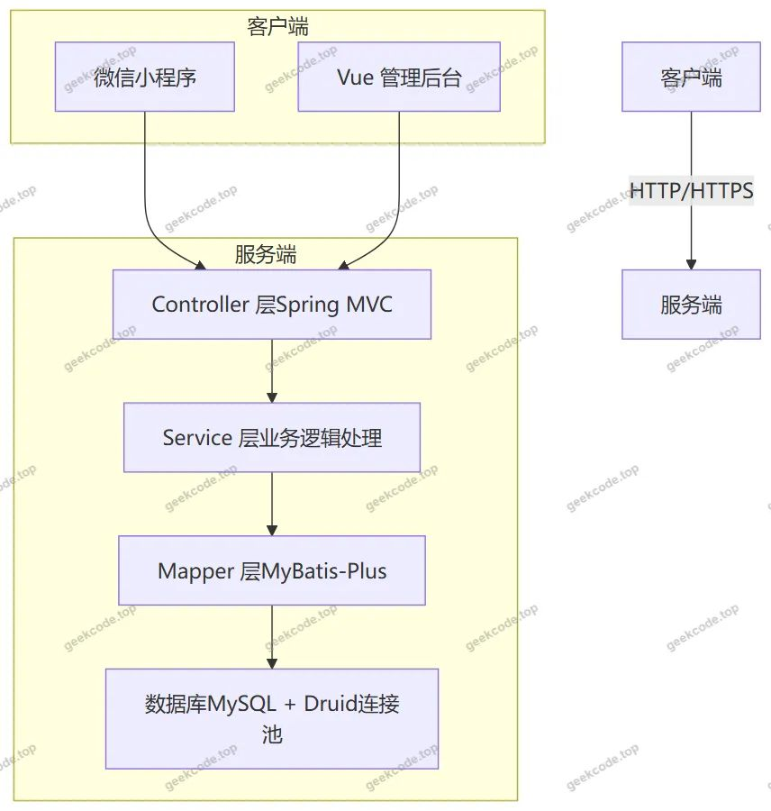</a>

<h3>2. 核心技术选型</h3>
<ul>
<li><strong>后端框架</strong>：基于 <code>Spring Boot</code> 生态体系，利用 <code>spring-core</code>, <code>spring-context</code>, <code>spring-webmvc</code> 等模块构建高效稳定的 Web 应用。通过 <code>spring-tx</code> 和 <code>spring-aop</code> 实现事务管理和面向切面编程，确保数据一致性与代码解耦。</li>
<li><strong>持久层框架</strong>：采用 <code>MyBatis-Plus</code> 作为 ORM 框架，简化 CRUD 操作并支持复杂查询；使用 <code>Druid</code> 作为数据库连接池，提供高性能的数据源管理及监控能力。</li>
<li><strong>前端技术</strong>：</li>
<li><strong>用户端</strong>：基于微信小程序原生开发或 Vue 集成方案（vue-integrated），实现移动端界面渲染。</li>
<li><strong>管理端</strong>：基于 Vue.js 构建单页应用（SPA），通过路由 <code>/news</code>, <code>/xuesheng</code> 等模块化管理后台页面。</li>
<li><strong>测试框架</strong>：引入 <code>junit</code> 进行单元测试，保障核心业务逻辑的正确性。</li>
</ul>
<h3>3. 数据库设计要点</h3>

数据库主要围绕新生报到业务实体建模，包括学生表 (<code>xuesheng</code>)、宿舍申请表 (<code>susheshenqing</code>)、军训服装表 (<code>junxunfuzhuang</code>)、一卡通办理表 (<code>yikatongbanli</code>)、缴费信息表 (<code>jiaofeixinxi</code>) 等。各表之间通过外键关联，支持一对一或一对多关系，如一个学生对应多条咨询记录或多条收藏记录。

<h2>功能模块</h2>

根据后台路由配置及小程序截图分析，系统功能划分为以下两大板块：

<h3>1. 前台用户端（微信小程序）</h3>
<ul>
<li><strong>基础服务</strong></li>
<li><strong>登录/注册</strong>：支持账号密码登录、新用户注册及忘记密码找回功能。</li>
<li><strong>个人中心</strong>：展示个人信息、我的收藏列表。</li>
<li><strong>报到业务流程</strong></li>
<li><strong>报道接站</strong>：查看接站安排详情，了解交通指引信息。</li>
<li><strong>报道信息</strong>：查看个人报到具体时间及地点详情。</li>
<li><strong>宿舍管理</strong>：浏览宿舍信息列表及详情，提交宿舍申请，查看申请状态。</li>
<li><strong>军训服装</strong>：浏览军训服装款式，进行在线选购，查看订单详情。</li>
<li><strong>一卡通办理</strong>：查看一卡通办理进度及相关说明。</li>
<li><strong>缴费信息</strong>：查询各项费用明细及缴纳状态。</li>
<li><strong>互动与服务</strong></li>
<li><strong>在线咨询</strong>：发起咨询请求，查看历史咨询列表及官方回复详情。</li>
<li><strong>志愿者服务</strong>：查看志愿者名单及详细信息，获取帮助。</li>
<li><strong>资讯动态</strong>：浏览学校发布的新闻公告。</li>
</ul>
<h3>2. 后台管理端（Web Admin）</h3>
<ul>
<li><strong>学生管理</strong> (<code>/xuesheng</code>)：录入、编辑、删除学生基本信息，审核学生身份。</li>
<li><strong>宿舍管理</strong> (<code>/sushexinxi</code>, <code>/susheshenqing</code>)：维护宿舍资源信息，审批学生的宿舍申请。</li>
<li><strong>服装管理</strong> (<code>/junxunfuzhuang</code>, <code>/xuangoufuzhuang</code>)：发布军训服装信息，管理学生的选购订单。</li>
<li><strong>报到服务</strong> (<code>/baodaoxinxi</code>, <code>/baodaojiezhan</code>, <code>/jiaotongzhiyin</code>)：配置报到时间、接站路线及交通指引内容。</li>
<li><strong>财务与服务</strong> (<code>/jiaofeixinxi</code>, <code>/yikatongbanli</code>)：更新缴费通知，处理一卡通办理业务。</li>
<li><strong>互动管理</strong> (<code>/discussjunxunfuzhuang</code>, <code>/zaixianzixun</code>, <code>/zixunhuifu</code>)：管理军训服装评论，处理在线咨询及回复。</li>
<li><strong>内容与配置</strong> (<code>/news</code>, <code>/config</code>, <code>/storeup</code>, <code>/zhiyuanzhe</code>)：发布新闻资讯，管理系统全局参数，查看用户收藏数据，维护志愿者信息库。</li>
</ul>
<h2>用户角色与权限</h2>

系统主要包含两种用户角色，权限边界清晰：

<h3>1. 普通用户（新生）</h3>
<ul>
<li><strong>访问范围</strong>：仅限微信小程序端。</li>
<li><strong>核心权限</strong>：</li>
<li><strong>读写权限</strong>：可修改个人基本信息，提交宿舍申请、购买军训服装、发起在线咨询。</li>
<li><strong>只读权限</strong>：可查看报到指南、交通指引、新闻公告、志愿者信息、缴费标准及系统回复。</li>
<li><strong>数据隔离</strong>：仅能查看和操作属于自己账户下的数据（如自己的订单、自己的申请）。</li>
</ul>
<h3>2. 管理员</h3>
<ul>
<li><strong>访问范围</strong>：Web 后台管理系统及部分小程序管理视图（如截图所示“小程序-管理端”）。</li>
<li><strong>核心权限</strong>：</li>
<li><strong>全量数据管理</strong>：拥有对所有业务表（学生、宿舍、服装、咨询等）的增删改查权限。</li>
<li><strong>审核权限</strong>：负责审批宿舍申请、处理一卡通办理状态、回复在线咨询。</li>
<li><strong>内容发布</strong>：发布新闻报道、更新交通指引、配置系统参数。</li>
<li><strong>统计查看</strong>：查看所有用户的收藏记录、评论内容及整体运营数据。</li>
</ul>
<h2>项目特色与创新点</h2>
<ol>
<li><strong>全流程数字化报到</strong>：将传统线下复杂的报到环节（接站、住宿、服装、办卡、缴费）整合至线上，实现“指尖上的报到”，显著降低现场拥堵，提升用户体验。</li>
<li><strong>双向互动机制</strong>：不仅提供单向的信息发布，还集成了“在线咨询”与“志愿反馈”模块，建立了新生与管理者、志愿者之间的即时沟通渠道，增强了服务的响应速度。</li>
<li><strong>轻量化前端接入</strong>：基于微信小程序开发，无需下载安装 APP，利用微信生态的高覆盖率，降低了新生的使用门槛和推广成本。</li>
<li><strong>模块化后台管理</strong>：后台功能严格遵循 RBAC（基于角色的访问控制）思想，针对宿舍、服装、财务等不同业务域划分独立的管理路由，便于不同职能部门协同工作。</li>
</ol>
<h2>部署环境</h2>

为确保系统稳定运行，建议部署环境如下：

<ul>
<li><strong>操作系统</strong>：Linux (CentOS 7+ / Ubuntu 20.04+) 或 Windows Server 2016+。</li>
<li><strong>Java 环境</strong>：JDK 1.8 及以上版本。</li>
<li><strong>数据库</strong>：MySQL 5.7 或 MySQL 8.0。</li>
<li><strong>缓存中间件</strong>：Redis (可选，用于会话管理或热点数据缓存)。</li>
<li><strong>Web 服务器</strong>：Nginx (用于反向代理静态资源及负载均衡) 或内置 Tomcat。</li>
<li><strong>前端构建工具</strong>：Node.js (v14+), npm/yarn (用于编译 Vue 管理后台及小程序源码)。</li>
<li><strong>开发调试工具</strong>：微信开发者工具 (用于小程序真机调试与预览)。</li>
</ul>
<h2>五、技术特性</h2>
<ul>
<li>前后端集成部署，前端资源打包至后端 static 目录</li>
<li>使用 MyBatis-Plus 简化数据访问层开发</li>
</ul>
<h2>六、功能模块截图</h2>
<h3>前台用户端</h3>
<h4>前台首页框架</h4>

<a href="https://geekcode.top/archives/%E5%9F%BA%E4%BA%8E%E5%BE%AE%E4%BF%A1%E5%B0%8F%E7%A8%8B%E5%BA%8F%E7%9A%84%E6%96%B0%E7%94%9F%E8%87%AA%E5%8A%A9%E6%8A%A5%E5%88%B0%E7%B3%BB%E7%BB%9F-%E8%AE%BA%E6%96%87?utm_source=github" title="查看完整源码">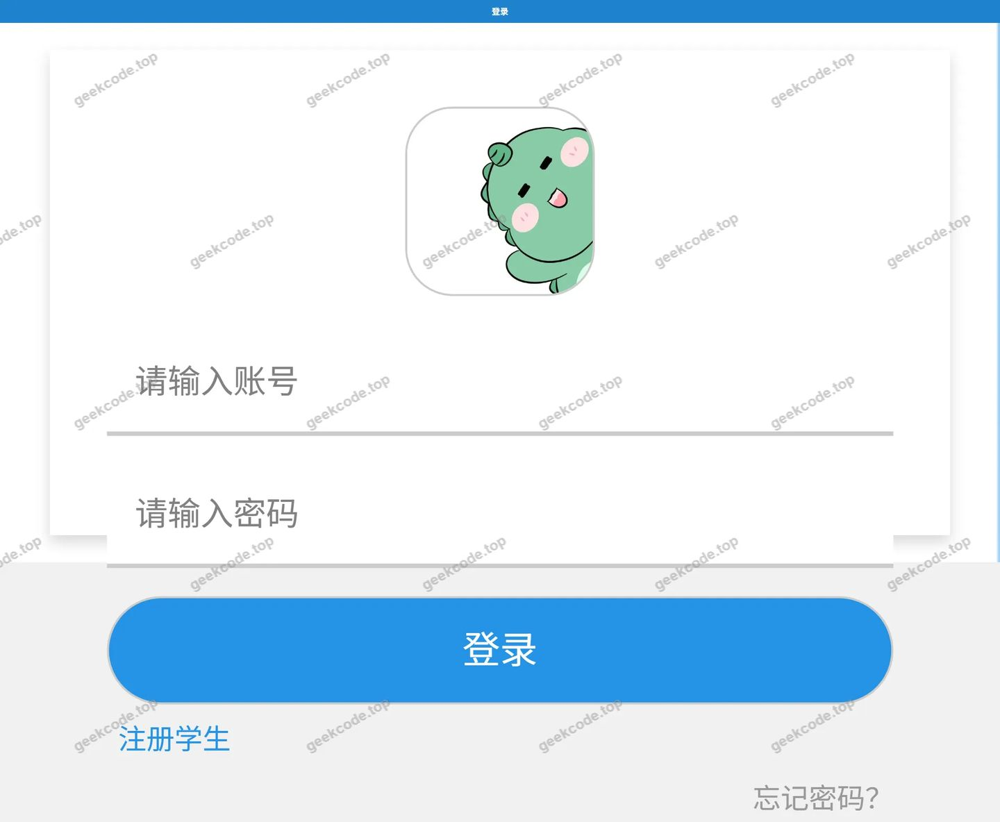</a>

<h3>微信小程序用户端</h3>

<figure><figcaption>小程序-报道接站</figcaption></figure>
<figure><figcaption>小程序-报道接站详情</figcaption></figure>
<figure><a href="https://geekcode.top/archives/%E5%9F%BA%E4%BA%8E%E5%BE%AE%E4%BF%A1%E5%B0%8F%E7%A8%8B%E5%BA%8F%E7%9A%84%E6%96%B0%E7%94%9F%E8%87%AA%E5%8A%A9%E6%8A%A5%E5%88%B0%E7%B3%BB%E7%BB%9F-%E8%AE%BA%E6%96%87?utm_source=github" title="查看完整源码">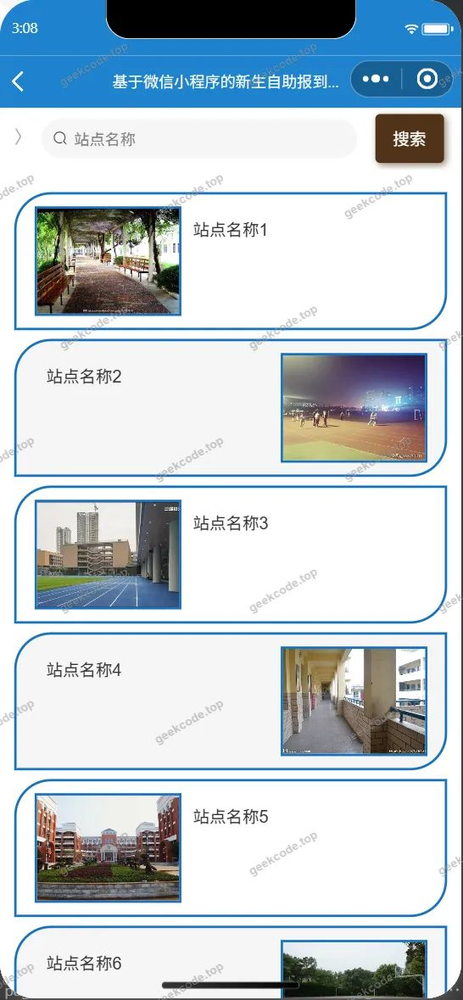</a><figcaption>小程序-报道信息列表</figcaption></figure>
<figure><figcaption>小程序-报道信息详情</figcaption></figure>
<figure><figcaption>小程序-登录</figcaption></figure>
<figure><figcaption>小程序-个人信息</figcaption></figure>
<figure><a href="https://geekcode.top/archives/%E5%9F%BA%E4%BA%8E%E5%BE%AE%E4%BF%A1%E5%B0%8F%E7%A8%8B%E5%BA%8F%E7%9A%84%E6%96%B0%E7%94%9F%E8%87%AA%E5%8A%A9%E6%8A%A5%E5%88%B0%E7%B3%BB%E7%BB%9F-%E8%AE%BA%E6%96%87?utm_source=github" title="查看完整源码">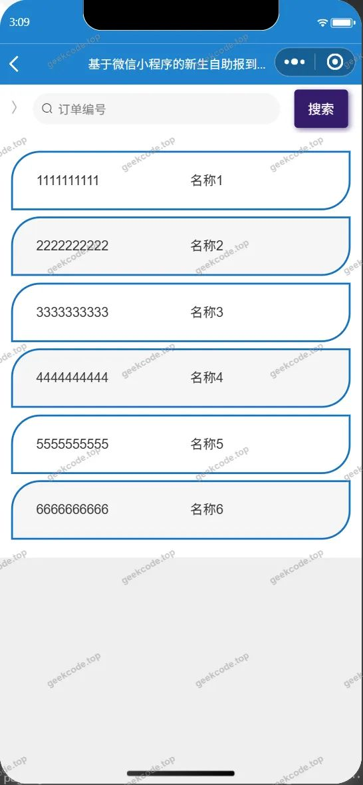</a><figcaption>小程序-缴费信息列表</figcaption></figure>
<figure><figcaption>小程序-缴费信息详情</figcaption></figure>
<figure><figcaption>小程序-军训服装列表</figcaption></figure>
<figure><figcaption>小程序-军训服装详情</figcaption></figure>
<figure><figcaption>小程序-首页</figcaption></figure>
<figure><a href="https://geekcode.top/archives/%E5%9F%BA%E4%BA%8E%E5%BE%AE%E4%BF%A1%E5%B0%8F%E7%A8%8B%E5%BA%8F%E7%9A%84%E6%96%B0%E7%94%9F%E8%87%AA%E5%8A%A9%E6%8A%A5%E5%88%B0%E7%B3%BB%E7%BB%9F-%E8%AE%BA%E6%96%87?utm_source=github" title="查看完整源码">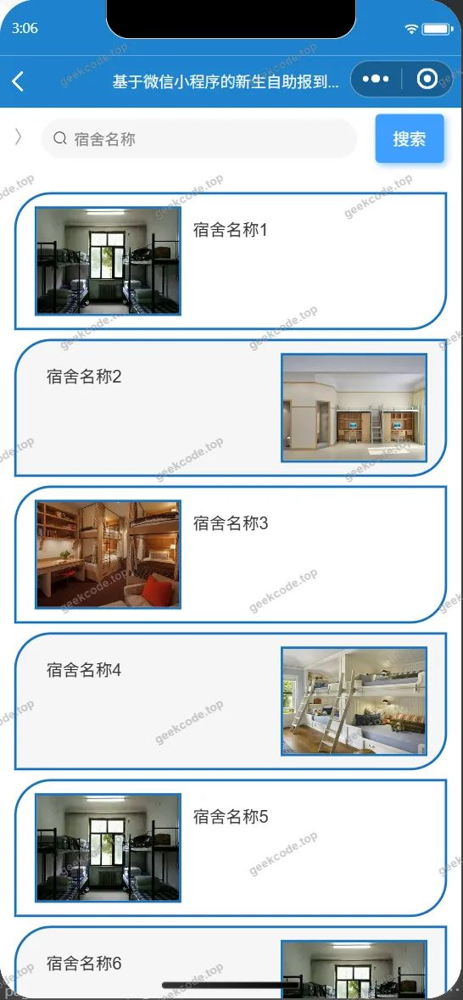</a><figcaption>小程序-宿舍申请列表</figcaption></figure>
<figure><a href="https://geekcode.top/archives/%E5%9F%BA%E4%BA%8E%E5%BE%AE%E4%BF%A1%E5%B0%8F%E7%A8%8B%E5%BA%8F%E7%9A%84%E6%96%B0%E7%94%9F%E8%87%AA%E5%8A%A9%E6%8A%A5%E5%88%B0%E7%B3%BB%E7%BB%9F-%E8%AE%BA%E6%96%87?utm_source=github" title="查看完整源码">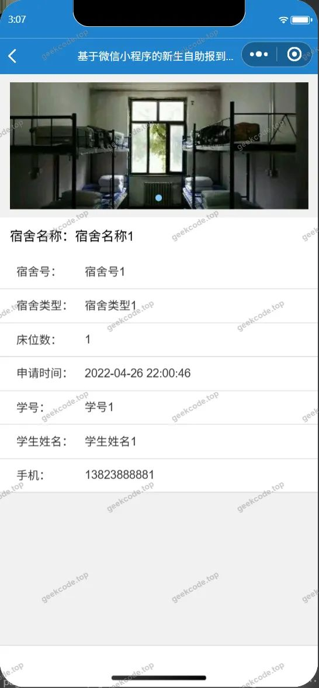</a><figcaption>小程序-宿舍申请详情</figcaption></figure>
<figure><a href="https://geekcode.top/archives/%E5%9F%BA%E4%BA%8E%E5%BE%AE%E4%BF%A1%E5%B0%8F%E7%A8%8B%E5%BA%8F%E7%9A%84%E6%96%B0%E7%94%9F%E8%87%AA%E5%8A%A9%E6%8A%A5%E5%88%B0%E7%B3%BB%E7%BB%9F-%E8%AE%BA%E6%96%87?utm_source=github" title="查看完整源码">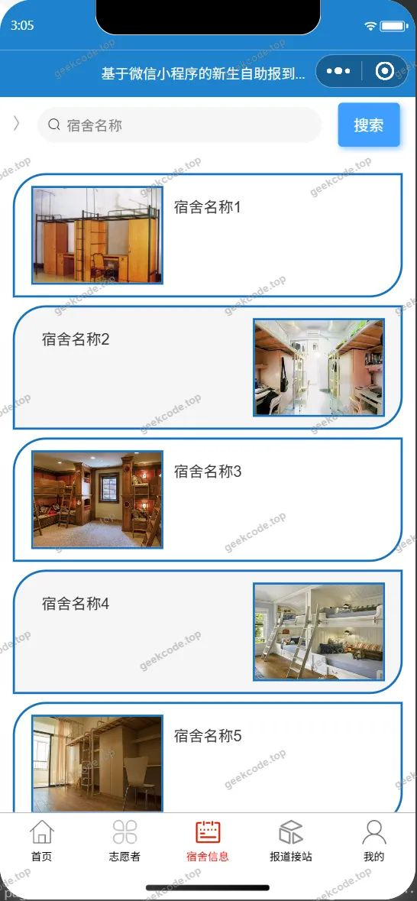</a><figcaption>小程序-宿舍信息</figcaption></figure>
<figure><figcaption>小程序-宿舍信息详情</figcaption></figure>
<figure><figcaption>小程序-忘记密码</figcaption></figure>
<figure><a href="https://geekcode.top/archives/%E5%9F%BA%E4%BA%8E%E5%BE%AE%E4%BF%A1%E5%B0%8F%E7%A8%8B%E5%BA%8F%E7%9A%84%E6%96%B0%E7%94%9F%E8%87%AA%E5%8A%A9%E6%8A%A5%E5%88%B0%E7%B3%BB%E7%BB%9F-%E8%AE%BA%E6%96%87?utm_source=github" title="查看完整源码">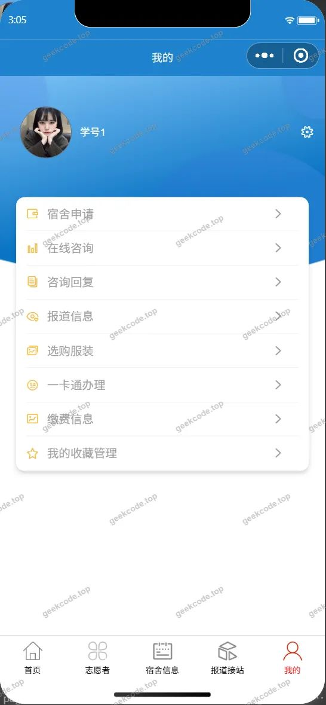</a><figcaption>小程序-我的</figcaption></figure>
<figure><figcaption>小程序-我的收藏列表</figcaption></figure>
<figure><figcaption>小程序-选购服装列表</figcaption></figure>
<figure><figcaption>小程序-选购服装详情</figcaption></figure>
<figure><figcaption>小程序-一卡通办理列表</figcaption></figure>
<figure><figcaption>小程序-一卡通办理详情</figcaption></figure>
<figure><a href="https://geekcode.top/archives/%E5%9F%BA%E4%BA%8E%E5%BE%AE%E4%BF%A1%E5%B0%8F%E7%A8%8B%E5%BA%8F%E7%9A%84%E6%96%B0%E7%94%9F%E8%87%AA%E5%8A%A9%E6%8A%A5%E5%88%B0%E7%B3%BB%E7%BB%9F-%E8%AE%BA%E6%96%87?utm_source=github" title="查看完整源码">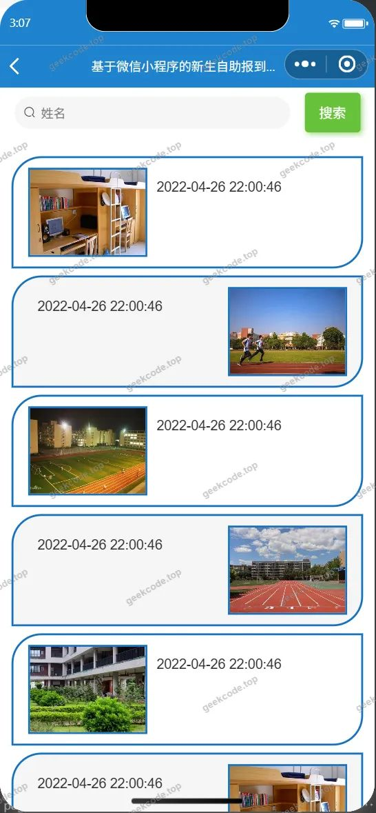</a><figcaption>小程序-在线咨询列表</figcaption></figure>
<figure><a href="https://geekcode.top/archives/%E5%9F%BA%E4%BA%8E%E5%BE%AE%E4%BF%A1%E5%B0%8F%E7%A8%8B%E5%BA%8F%E7%9A%84%E6%96%B0%E7%94%9F%E8%87%AA%E5%8A%A9%E6%8A%A5%E5%88%B0%E7%B3%BB%E7%BB%9F-%E8%AE%BA%E6%96%87?utm_source=github" title="查看完整源码">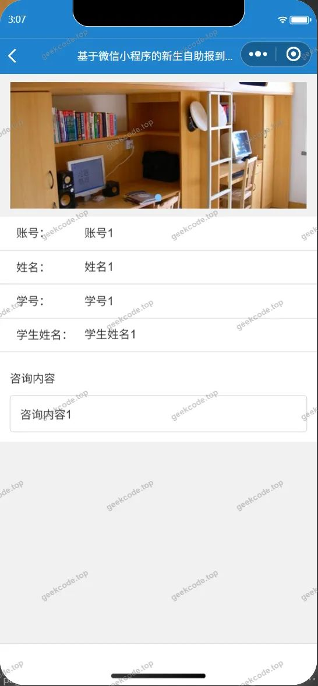</a><figcaption>小程序-在线咨询详情</figcaption></figure>
<figure><figcaption>小程序-志愿者</figcaption></figure>
<figure><figcaption>小程序-志愿者详情</figcaption></figure>
<figure><figcaption>小程序-注册</figcaption></figure>
<figure><a href="https://geekcode.top/archives/%E5%9F%BA%E4%BA%8E%E5%BE%AE%E4%BF%A1%E5%B0%8F%E7%A8%8B%E5%BA%8F%E7%9A%84%E6%96%B0%E7%94%9F%E8%87%AA%E5%8A%A9%E6%8A%A5%E5%88%B0%E7%B3%BB%E7%BB%9F-%E8%AE%BA%E6%96%87?utm_source=github" title="查看完整源码">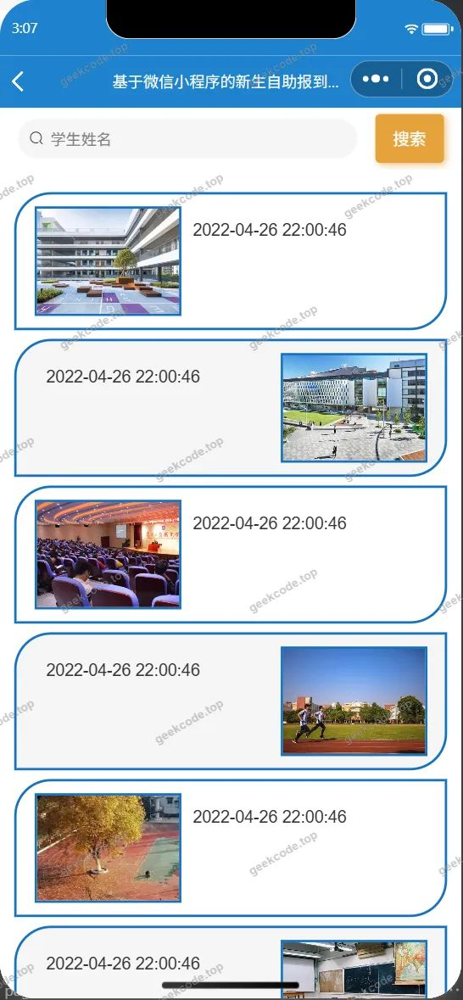</a><figcaption>小程序-咨询回复列表</figcaption></figure>
<figure><figcaption>小程序-咨询回复详情</figcaption></figure>
<figure><a href="https://geekcode.top/archives/%E5%9F%BA%E4%BA%8E%E5%BE%AE%E4%BF%A1%E5%B0%8F%E7%A8%8B%E5%BA%8F%E7%9A%84%E6%96%B0%E7%94%9F%E8%87%AA%E5%8A%A9%E6%8A%A5%E5%88%B0%E7%B3%BB%E7%BB%9F-%E8%AE%BA%E6%96%87?utm_source=github" title="查看完整源码">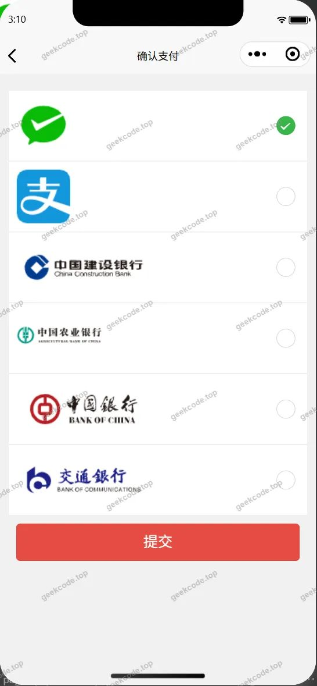</a><figcaption>小程序-payconfirm</figcaption></figure>

<h3>微信小程序管理端</h3>

<figure><figcaption>小程序-管理端-报道指南列表</figcaption></figure>
<figure><figcaption>小程序-管理端-交通指引列表</figcaption></figure>
<figure><figcaption>小程序-管理端-学生列表</figcaption></figure>
<figure><figcaption>小程序-管理端-学生详情</figcaption></figure>

<h3>后台管理端</h3>
<h4>后台-报道指南</h4>

<a href="https://geekcode.top/archives/%E5%9F%BA%E4%BA%8E%E5%BE%AE%E4%BF%A1%E5%B0%8F%E7%A8%8B%E5%BA%8F%E7%9A%84%E6%96%B0%E7%94%9F%E8%87%AA%E5%8A%A9%E6%8A%A5%E5%88%B0%E7%B3%BB%E7%BB%9F-%E8%AE%BA%E6%96%87?utm_source=github" title="查看完整源码">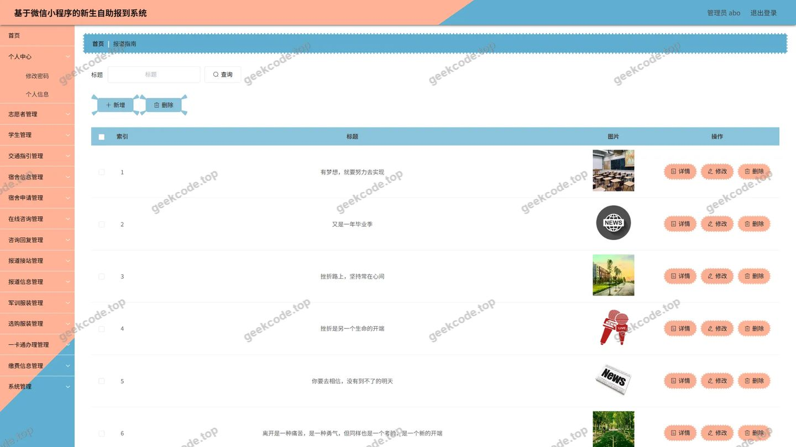</a>

<h4>后台-登录页</h4>

<a href="https://geekcode.top/archives/%E5%9F%BA%E4%BA%8E%E5%BE%AE%E4%BF%A1%E5%B0%8F%E7%A8%8B%E5%BA%8F%E7%9A%84%E6%96%B0%E7%94%9F%E8%87%AA%E5%8A%A9%E6%8A%A5%E5%88%B0%E7%B3%BB%E7%BB%9F-%E8%AE%BA%E6%96%87?utm_source=github" title="查看完整源码">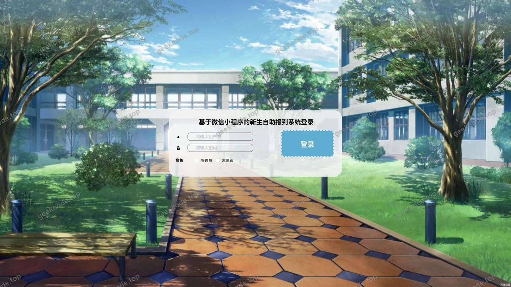</a>

<h4>后台-军训服装评论</h4>

<a href="https://geekcode.top/archives/%E5%9F%BA%E4%BA%8E%E5%BE%AE%E4%BF%A1%E5%B0%8F%E7%A8%8B%E5%BA%8F%E7%9A%84%E6%96%B0%E7%94%9F%E8%87%AA%E5%8A%A9%E6%8A%A5%E5%88%B0%E7%B3%BB%E7%BB%9F-%E8%AE%BA%E6%96%87?utm_source=github" title="查看完整源码">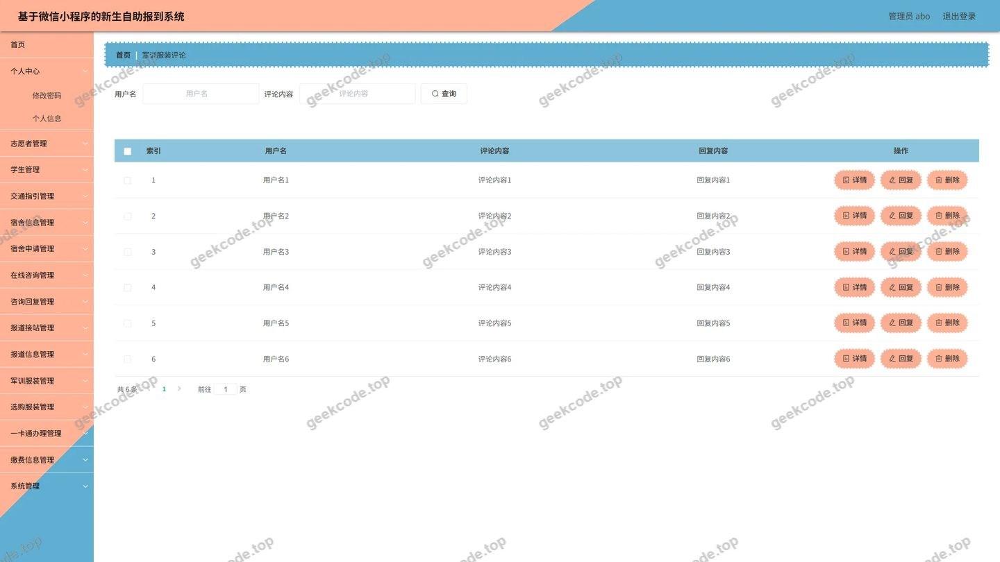</a>

<h4>后台-收藏</h4>

<a href="https://geekcode.top/archives/%E5%9F%BA%E4%BA%8E%E5%BE%AE%E4%BF%A1%E5%B0%8F%E7%A8%8B%E5%BA%8F%E7%9A%84%E6%96%B0%E7%94%9F%E8%87%AA%E5%8A%A9%E6%8A%A5%E5%88%B0%E7%B3%BB%E7%BB%9F-%E8%AE%BA%E6%96%87?utm_source=github" title="查看完整源码">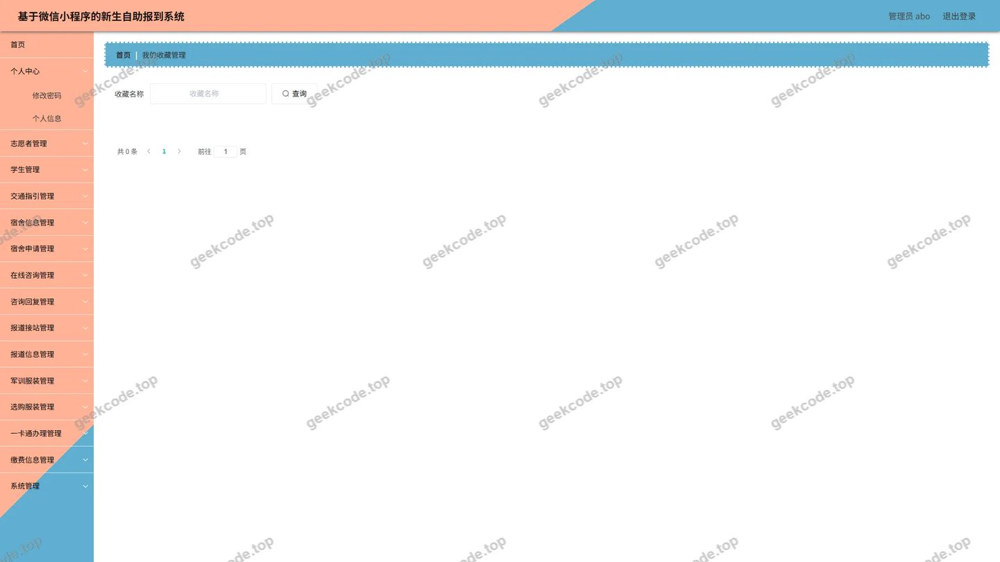</a>

<h4>后台首页</h4>

<a href="https://geekcode.top/archives/%E5%9F%BA%E4%BA%8E%E5%BE%AE%E4%BF%A1%E5%B0%8F%E7%A8%8B%E5%BA%8F%E7%9A%84%E6%96%B0%E7%94%9F%E8%87%AA%E5%8A%A9%E6%8A%A5%E5%88%B0%E7%B3%BB%E7%BB%9F-%E8%AE%BA%E6%96%87?utm_source=github" title="查看完整源码">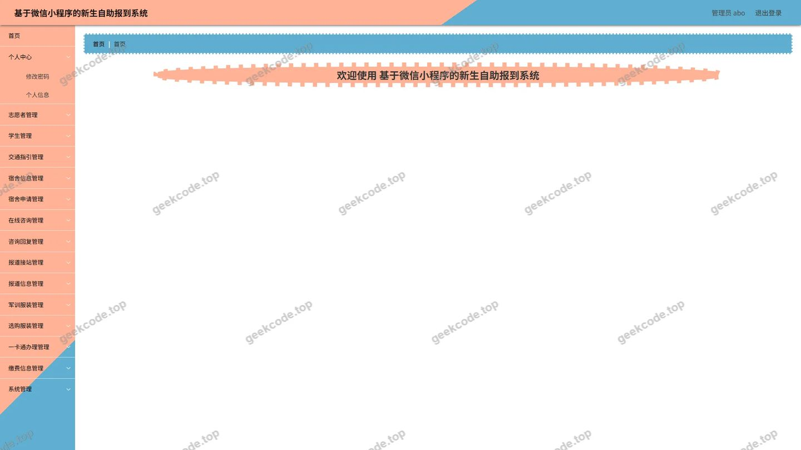</a>

<h4>后台-选购服装</h4>

<a href="https://geekcode.top/archives/%E5%9F%BA%E4%BA%8E%E5%BE%AE%E4%BF%A1%E5%B0%8F%E7%A8%8B%E5%BA%8F%E7%9A%84%E6%96%B0%E7%94%9F%E8%87%AA%E5%8A%A9%E6%8A%A5%E5%88%B0%E7%B3%BB%E7%BB%9F-%E8%AE%BA%E6%96%87?utm_source=github" title="查看完整源码">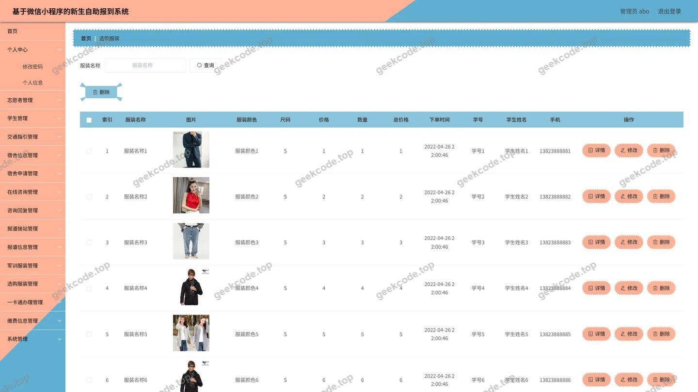</a>

<h4>后台-学生</h4>

<a href="https://geekcode.top/archives/%E5%9F%BA%E4%BA%8E%E5%BE%AE%E4%BF%A1%E5%B0%8F%E7%A8%8B%E5%BA%8F%E7%9A%84%E6%96%B0%E7%94%9F%E8%87%AA%E5%8A%A9%E6%8A%A5%E5%88%B0%E7%B3%BB%E7%BB%9F-%E8%AE%BA%E6%96%87?utm_source=github" title="查看完整源码">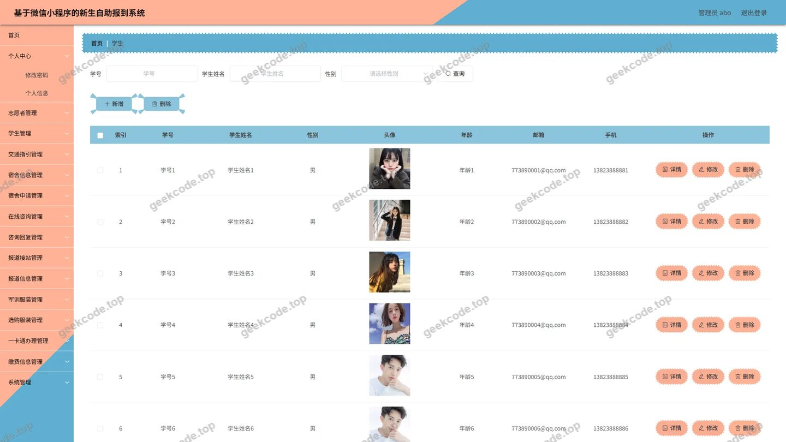</a>

<h4>后台-一卡通办理</h4>

<a href="https://geekcode.top/archives/%E5%9F%BA%E4%BA%8E%E5%BE%AE%E4%BF%A1%E5%B0%8F%E7%A8%8B%E5%BA%8F%E7%9A%84%E6%96%B0%E7%94%9F%E8%87%AA%E5%8A%A9%E6%8A%A5%E5%88%B0%E7%B3%BB%E7%BB%9F-%E8%AE%BA%E6%96%87?utm_source=github" title="查看完整源码">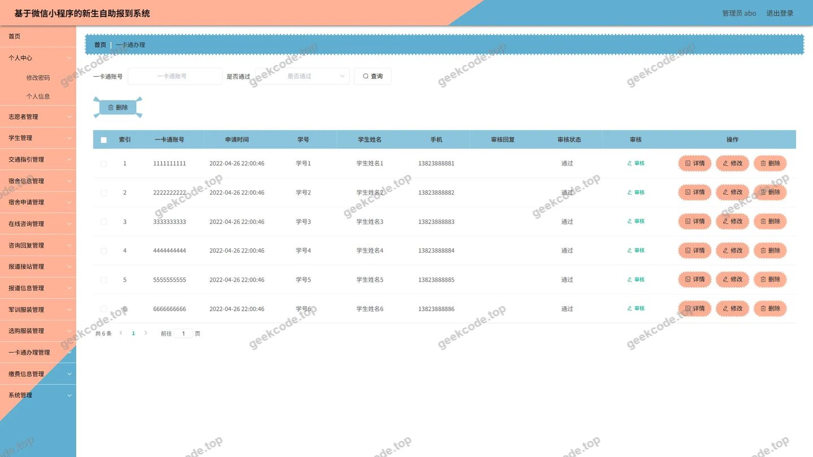</a>

---

## 获取完整源码

| 项目 | 说明 |
| --- | --- |
| 项目名 | 基于微信小程序的新生自助报到系统--论文 |
| 运行截图 | 本文 44 张（站点带水印原图，仓库 `images/` 目录） |
| 完整源码 | [https://geekcode.top/archives/%E5%9F%BA%E4%BA%8E%E5%BE%AE%E4%BF%A1%E5%B0%8F%E7%A8%8B%E5%BA%8F%E7%9A%84%E6%96%B0%E7%94%9F%E8%87%AA%E5%8A%A9%E6%8A%A5%E5%88%B0%E7%B3%BB%E7%BB%9F-%E8%AE%BA%E6%96%87?utm_source=github](https://geekcode.top/archives/%E5%9F%BA%E4%BA%8E%E5%BE%AE%E4%BF%A1%E5%B0%8F%E7%A8%8B%E5%BA%8F%E7%9A%84%E6%96%B0%E7%94%9F%E8%87%AA%E5%8A%A9%E6%8A%A5%E5%88%B0%E7%B3%BB%E7%BB%9F-%E8%AE%BA%E6%96%87?utm_source=github) |
| 咨询微信 | **ir9372**（备注：jingpin-yuanma） |
| 更多项目 | [极客代码 geekcode.top](https://geekcode.top/?utm_source=github) |

> 需要源码、部署、改配置、跑不起来等问题，加微信 ir9372 沟通，说明项目名即可。
